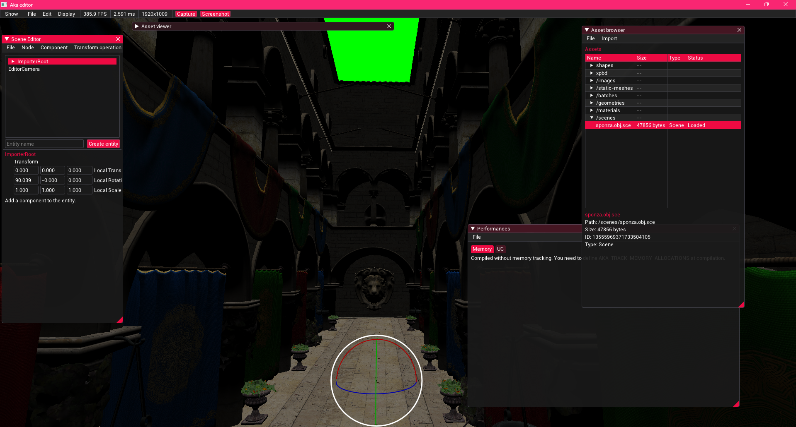

# AkaEngine

Didactic 3D engine based on [Aka framework](https://github.com/antaalt/Aka), which mostly focus on having solid foundation. Rendering is really basic for now.

## How to setup

> [!WARNING]
> If vcpkg installed and accessible globally, it might cause some issues. 
> The local version should be picked, but be aware of this.

1. Execute `bootstrap-windows.bat` or `bootstrap-unix.sh` in a terminal.
2. From this terminal, path & VCPKG_ROOT are set. You can install packages using `vcpkg install my-package`.
3. Configure Cmake >3.19 using default preset from `CMakePresets.json`. This way, it will automatically use local vcpkg toolchain and search for required packages.

It uses Ninja build system so be sure its installed. Visual studio should install it by default, else make sure to install CMake components.

### How to add packages and access vcpkg

The path is set locally in terminal when running bootstrap script.

So either:
- Run script before executing any operation with vcpkg 
- Set local vcpkg in path in windows directly. 

Then simply run `vcpkg add port mypackage`

## Features

- Asset manager
- Shader hot reload
- Vulkan based gfx backend
- Static & skeletal mesh rendering
- Scene importing via assimp

## Roadmap
- Some multithreading (via worker for asset loading & co)
- Asset indexer
  - Asset hot reloading
  - Shader indexation
- Rendering improvements
  - SSAO
  - Shadow mapping (CSM)
  - Directional lights / point lights / spot lights
  - Ray tracing shadows / lightings
  - Transparent rendering
  - FXAA
  - Skybox
- Blender renderer via python API ?
- A Game ???